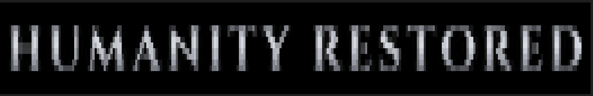

# Praise the Git &nbsp; \\[T]/

*— Prepare to Push Edition —*

Dark Souls banners for your git commands — metallic sheen, fade in/out,
solemn chime, and a souls counter (your total commit count) included.
Works on Linux, macOS, and Windows 10+ (cmd / Windows Terminal).

| git command                  | outcome    | banner               |
| ---------------------------- | ---------- | -------------------- |
| `git push`                   | success    | **CODE PUSHED**      |
| `git push`                   | failure    | **YOU DIED**         |
| `git merge` / `git rebase`   | success    | **VICTORY ACHIEVED** |
| `git merge` / `git rebase`   | conflict   | **YOU DIED**         |
| `git checkout -b` / `switch -c` | new branch | its name, like entering a new area |
| `git stash`                  | stashed    | **HUMANITY RESTORED** |

(`--abort`/`--quit` calls and a `git stash` that had nothing to save stay
silent; the git exit code is always preserved.)

## In action

| `git pull origin main` → merge conflict | `git push origin main` → pushed |
|:---:|:---:|
|  |  |
| **`git checkout -b undead-burg` → new branch** | **`git stash` → changes stashed** |
|  |  |

## Install

### macOS / Linux — one-liner install

```sh
curl -fsSL https://raw.githubusercontent.com/mohammadrezanorouzii/praise-the-git/main/install.sh | bash
```

This script will:

- Download the app into `~/.local/share/praise-the-git/app` (no sudo required)
- Install the `praise` command — via `pipx` if you have it, else
  `pip install --user`, else a plain symlink in `~/.local/bin`
- Add one marked block to your `~/.bashrc` / `~/.zshrc` that loads the git
  wrapper — this is what makes the banners fire automatically

It's idempotent — re-running it later updates the app.

> **Custom install dir** — set `PRAISE_INSTALL_DIR=/your/path` before piping
> to bash to put the app somewhere else.

Then reload your shell and check it works:

```sh
source ~/.bashrc     # or source ~/.zshrc, or just open a new terminal
praise-test          # golden CODE PUSHED banner + chime
```

If `praise` isn't found, `~/.local/bin` is missing from your PATH — add
`export PATH="$HOME/.local/bin:$PATH"` to your rc file and reload again.
From here on, just use git normally: the banners appear on their own.

### Windows — one-liner install (PowerShell)

```powershell
irm https://raw.githubusercontent.com/mohammadrezanorouzii/praise-the-git/main/install.ps1 | iex
```

This script will:

- Check that Python 3 is installed (get it from
  [python.org](https://www.python.org/downloads/) with "Add to PATH"
  checked — the script tells you if it's missing)
- Download the app into `%LOCALAPPDATA%\praise-the-git\app`
- pip-install the `praise` command and put `gitpush.cmd` into your
  per-user Python Scripts directory
- Add that Scripts directory to your user PATH if needed

Open a **new** terminal after installation, then:

```bat
praise                 # preview the banner
gitpush origin main    # instead of "git push"
```

cmd has no shell functions, so plain `git push` can't be intercepted the
way it is on Linux/macOS — `gitpush` runs the real push and shows the
banner based on its exit code. Works in classic cmd and Windows Terminal.

### Manual install

```sh
# just the `praise` command, no automatic git integration:
pipx install git+https://github.com/mohammadrezanorouzii/praise-the-git.git
# (or) pip install git+https://github.com/mohammadrezanorouzii/praise-the-git.git

# for the automatic banners, clone and run the installer from the checkout:
git clone https://github.com/mohammadrezanorouzii/praise-the-git.git
cd praise-the-git && ./install.sh      # Windows: install.bat
```

## Test

Preview every banner without touching git state (nothing is pushed,
merged, or stashed — git isn't even called):

```sh
praise-test            # CODE PUSHED + souls counter
praise-test fail       # YOU DIED
praise-test victory    # VICTORY ACHIEVED + souls counter
praise-test branch     # UNDEAD BURG, area-name style
praise-test stash      # HUMANITY RESTORED
```

The `praise` command itself takes any text, so you can test themes, the
souls counter, and static output directly:

```sh
praise "BONFIRE LIT"                  # any text, gold
praise --red "YOU DIED"               # red theme
praise --theme silver "UNDEAD BURG"   # gold / red / silver
praise --souls 1247 "CODE PUSHED"     # souls counter under the banner
praise --no-sound "QUIET"             # skip the chime
praise --dump "TEST"                  # one static frame, no animation
praise --png out.png "TEST"           # render a frame to an image file
```

To test the real git integration end to end, make a throwaway repo and
trigger a banner:

```sh
mkdir /tmp/playground && cd /tmp/playground && git init
echo hi > file.txt && git add . && git commit -m "first"
git checkout -b feature/bonfire     # area-name banner
echo more >> file.txt && git stash  # HUMANITY RESTORED
```

Banners only animate in interactive terminals — scripts, CI, and
non-interactive shells stay silent by design.

## Requirements

- Python 3.8+ (Pillow is installed automatically with the package; without
  it the banner falls back to a low-res built-in bitmap font)
- A truecolor terminal (any modern terminal; on Windows 10+ VT processing
  is enabled automatically)
- Sound is built in: `winsound` on Windows, `afplay` on macOS,
  `paplay`/`aplay`/`ffplay` on Linux — whichever exists; silence otherwise

## How sound effects work

A solemn chord swell is synthesized (pure stdlib, no audio dependencies)
on first run and saved into the app's data directory:

- Linux: `~/.local/share/praise-the-git/chime.wav`
- macOS: `~/Library/Application Support/praise-the-git/chime.wav`
- Windows: `%LOCALAPPDATA%\praise-the-git\chime.wav`

Playback uses whatever the OS provides: `winsound` on Windows, `afplay`
on macOS, `paplay`/`aplay`/`ffplay` on Linux — silence if none exists.
Want a different sound? Replace that `chime.wav` with any `.wav` file
(e.g. the real "Victory Achieved" sound) and it plays instead. Delete it
to get the synthesized one back.

## Uninstall

### Linux / macOS

```sh
# 1. remove the shell integration block from your rc file(s)
sed -i '/>>> praise-the-git/,/<<< praise-the-git/d' ~/.bashrc
sed -i '/>>> praise-the-git/,/<<< praise-the-git/d' ~/.zshrc   # if you use zsh

# 2. remove the command (use the one matching how it was installed)
pipx uninstall praise-the-git        # pipx install
pip uninstall praise-the-git         # pip install
rm ~/.local/bin/praise               # symlink fallback

# 3. remove the downloaded app and the generated sound file
rm -rf ~/.local/share/praise-the-git
```

### Windows

```bat
rem 1. remove the package
pip uninstall praise-the-git

rem 2. find and delete the gitpush shim
where gitpush
del "<the path that 'where gitpush' printed>"

rem 3. remove the downloaded app and the generated sound file
rmdir /s /q "%LOCALAPPDATA%\praise-the-git"
```

## License

Code: MIT. The bundled Cinzel font is licensed under the SIL Open Font
License 1.1 (https://openfontlicense.org), © The Cinzel Project Authors.

---

*Inspired by the "Email Sent" Dark Souls browser extension, rebuilt for
the terminal.*
